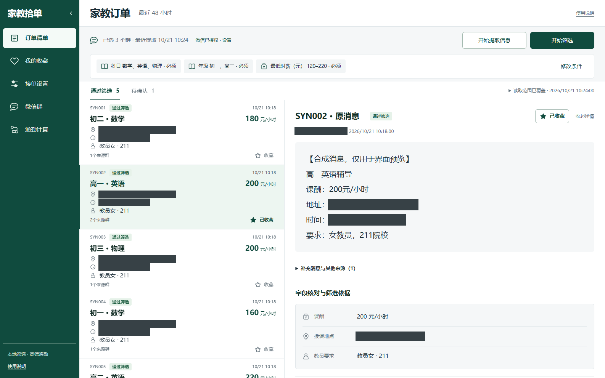

# 家教拾单 · 微信家教订单本地筛选助手

在自己的 Windows 电脑上，从已登录微信的指定群聊读取近 48 小时文字消息，使用本地规则切分订单、识别字段，并按接单条件筛选。

**当前流程不调用 AI。** 提取微信消息与筛选已有信息是两个独立操作；修改条件后，可以直接重新筛选，无需重复读取微信。

提供 Windows 10/11 x64 运行包，无需安装 Python；也可以从源码运行。每位使用者在自己的电脑登录自己的微信，本项目不提供在线账号系统或手机应用。

**新版界面与微信兼容测试版：** [下载 v0.2.4-rc.2](https://github.com/Huoxixi/tutor-assistant/releases/download/v0.2.4-rc.2/TutorAssistant-v0.2.4-rc.2-windows-x64.zip)，采用深绿侧栏、紧凑订单列表与宽原文阅读区，展开显示课酬、地点和教员要求的核对摘要。兼容能力沿用 v0.2.4-rc.1，按界面能力和二进制特征适配微信4.1+ x64，支持常驻和折叠搜索入口。4.1.15.56尚待目标电脑实际读取验证；不能将特征识别通过视为所有版本读取成功。连接失败时可在启动窗口一键生成无聊天正文的兼容性诊断。

## 功能

- **先授权，再读取**：每次启动默认未授权。点击“同意并授权”后才可检查和连接微信，授权不会自动提取。
- **提取与筛选分开**：“开始提取信息”只读取并保存所选群消息；“开始筛选”只处理本机已有信息。
- **本地解析**：按单号和消息模板切单，识别科目、年级、地点、课酬、课时、教员要求等字段，保留原文依据。
- **条件筛选**：支持性别、院校层次，以及薪资、科目、年级、多个教学地区。明确满足全部适用硬条件才算通过，缺失或不确定的要求保留为“待确认”。
- **按单号去重**：相同单号合并显示，保留全部原消息来源；无单号记录不强行合并，最新版本冲突时待确认。
- **原文与收藏**：点击订单标题直接查看这一单的原消息，支持本机长期收藏。
- **进度与停止**：提取、筛选显示运行状态；可停止任务，保留已保存信息及已完成结果。
- **可选高德通勤**：独立配置 Web 服务 Key 与地址查询授权，手动确认固定出发点，只对已收藏的订单逐条查询公交、步行或驾车路线，不改动原筛选结论。



*上图使用合成群名和计数，不包含真实聊天记录。*

## 运行环境

| 项目 | 要求或验证范围 |
| --- | --- |
| 操作系统 | Windows，微信读取依赖 Windows UI Automation |
| Python | EXE 运行包不需要安装；源码版需 3.11 及以上，推荐 3.13，本机验证版本为 3.13.14 |
| 微信 | 已登录的电脑版微信；本机曾验证 4.1.15.13，其他版本需测试 |
| 页面 | EXE 自动打开本地页面；源码默认 `http://127.0.0.1:8765` |
| API 密钥 | 本地识别和筛选不需要；可选通勤计算需要高德 Web 服务 Key，无需模型密钥 |

请保持桌面解锁、微信登录，读取期间避免同时操作微信。检测到微信进程不等于已登录、历史记录可读或读取范围完整。

## 快速开始

### 1. 获取源码

```powershell
git clone https://github.com/Huoxixi/tutor-assistant.git
cd tutor-assistant
```

也可在 GitHub 选择 **Code → Download ZIP**，解压后进入项目目录。

### 2. 首次安装并启动

安装 Python 3.13 后，在项目目录打开 PowerShell：

```powershell
.\start.ps1 -InstallWeChat
```

脚本创建项目独立环境 `.venv313`，安装基础依赖和微信读取组件，再启动本地服务。首次安装依赖需要网络连接。

如果找不到 Python，请指定实际安装位置：

```powershell
.\start.ps1 -PythonPath 'C:\你的Python目录\python.exe' -InstallWeChat
```

如果 PowerShell 提示不允许运行脚本，可只对这一次启动使用：

```powershell
powershell -NoProfile -ExecutionPolicy Bypass -File .\start.ps1 -InstallWeChat
```

安装完成后，后续双击 `start.cmd`，或运行 `.\start.ps1`。`start.cmd` 不会自动补装微信组件，首次使用请先执行带 `-InstallWeChat` 的命令。

### 3. 打开页面

浏览器访问 **http://127.0.0.1:8765/**。程序只监听本机回环地址，不发布到公网。关闭运行窗口或按 `Ctrl+C` 停止服务，已有数据保留。

### 手动安装

```powershell
py -3.13 -m venv .venv313
.\.venv313\Scripts\python.exe -m pip install -r requirements-wechat.txt
.\.venv313\Scripts\python.exe run.py
```

仅开发本地解析和筛选时，可安装 `requirements.txt`，无需安装或启动微信。`requirements-lock.txt` 是已验证 Windows 环境的版本快照，不是所有平台的通用锁文件。

## 使用方法

桌面默认使用带文字标签的深绿导航，点击栏顶箭头可收起或展开；同一浏览器会记住状态。订单页与收藏页采用左侧连续清单、右侧原消息的双栏布局，点击订单标题核对原文；窄屏与手机改为清单在前、原文在后的上下阅读。手机点击“菜单”打开侧边栏，点栏内箭头、遮罩或按 Escape 关闭；键盘 Tab 在展开的导航内循环，关闭后返回“菜单”。日常流程为：本地筛选 → 核对原文 → 收藏候选 → 从固定出发点逐条计算。场景分工见 [通勤计算使用流程](docs/commute-workflow.md)。

1. **登录微信**：在电脑版微信中登录自己的账号，不在本程序填写微信密码。
2. **确认授权**：阅读页面上方的读取范围，点击“同意并授权”。授权仅本次运行有效，刷新页面保留，重启程序后重新确认。
3. **设置条件**：进入“需求设置”，填写性别、院校层次、薪资、科目、年级和教学地区。保存后按新条件重新计算已有订单，不自动提取。
4. **选择群聊**：进入“微信群”，输入完整群名并添加，勾选来源。每次最多 10 个群，选择自动保存。
5. **提取信息**：点击“开始提取信息”，保存所选群近 48 小时内本机可访问的文字消息。完成或停止后查看读取状态。
6. **开始筛选**：点击“开始筛选”，对已保存的所选群消息切单、识别字段并筛选。已经提取过时，可直接从这一步开始。
7. **查看原文**：在“通过筛选”或“待确认”中查看详情、原消息及字段依据，按需收藏。

“撤销授权”会请求停止正在进行的微信读取，并阻止后续连接与提取。原消息、配置和收藏保留，未授权时仍可查看、筛选已有信息。

### 筛选结果

| 状态 | 含义 |
| --- | --- |
| 通过筛选 | 已识别字段明确满足全部适用硬条件 |
| 待确认 | 缺少关键字段、地点归属不确定，或有当前资料无法核实的额外要求 |
| 排除 | 至少一项硬条件明确不满足，不显示在主清单的两个标签中 |

不将缺失信息当作满足条件，不为增加通过数量放宽要求。单次课酬缺课时不当作时薪，月薪不擅自换算；原文只写城市而筛选要求具体区县时，不猜地点归属。

### 可选高德通勤计算

进入侧边栏“通勤计算”，根据页面的“下一步”提示保存高德 **Web 服务** Key、授权地址查询，再手动输入城市与学校或住处并确认出发点。程序不读取设备位置。

先收藏感兴趣的订单，再进入“我的收藏”点击“计算通勤”或打开收藏详情，点击“查询家教地点”，核对高德返回的位置与原消息一致后点击“用此位置计算”。列表优先显示完整授课地址；地区筛选仍使用区县，通勤查询另用路名、路号、弄号和小区等详细信息，并显示实际检索地址。明确区县的城市归属在本地区划表中唯一时，可仅为查询补足城市，不改写原字段或筛选结论。原文只有区县、城市不能确定或高德仅返回区县中心时，不计算虚假的精确距离。路线按查询时刻估算，不按订单上课时间规划；目前仅作参考，不作为新的硬筛选条件。

不会在启动、刷新或本地筛选时自动查询高德。每次请求可能消耗配额或产生费用，撤销位置授权后拦截后续请求并忽略在途结果；已经发送的请求无法撤回。结果仅在当前页面内存中使用，刷新清除，不持久缓存路线响应。详细步骤见 [高德申请与试用说明](docs/amap-setup.md)。**本轮使用模拟接口验证，未代用户查询真实地址或验收真实路线。**

## 开源技术与致谢

| 技术 | 本项目用途 | 许可 |
| --- | --- | --- |
| [Python](https://www.python.org/) | 本地规则、读取调度、业务逻辑 | PSF |
| [FastAPI](https://github.com/fastapi/fastapi) | 本地 HTTP API 与页面服务 | MIT |
| [Uvicorn](https://github.com/Kludex/uvicorn) | ASGI 服务进程 | BSD-3-Clause |
| [Pydantic](https://github.com/pydantic/pydantic) | 消息、条件和字段数据校验 | MIT |
| [HTTPX](https://github.com/encode/httpx) | 可选高德地址和路线请求 | BSD-3-Clause |
| [SQLite](https://www.sqlite.org/copyright.html) | 本地消息、订单、收藏与配置 | Public Domain |
| [pywechat / pywechat127](https://github.com/Hello-Mr-Crab/pywechat) | Windows 微信导航适配，模块名 `pyweixin` | LGPLv3，见下文 |
| [pywinauto](https://github.com/pywinauto/pywinauto) / [pywin32](https://github.com/mhammond/pywin32) | Windows 控件操作、COM 与密钥加密支持 | BSD / PSF，见第三方说明 |
| [Vant Area Data](https://github.com/youzan/vant/tree/main/packages/vant-area-data) | 省、市、区县选择与匹配数据 | MIT |
| [pytest](https://github.com/pytest-dev/pytest) | 合成数据及隔离回归测试 | MIT |

前端使用原生 HTML、CSS 和 JavaScript，不依赖云端 CDN。Windows UI Automation 与 DPAPI 是系统能力，不是本项目的开源组件。微信客户端不随仓库分发，本项目不是微信官方产品。

微信依赖固定为 `pywechat127==1.9.8`，该发行包标注 LGPLv3；上游主分支许可文本与发行包元数据可能不同，请按所用版本核对。本项目通过正常 Python 导入使用组件，不复制或修改第三方包实现。

完整归属、已验证版本与许可链接见 [THIRD_PARTY_NOTICES.md](THIRD_PARTY_NOTICES.md)。地区数据许可原文保留在 [app/assets/regions-LICENSE.txt](app/assets/regions-LICENSE.txt)。

## 数据与隐私

- 源码版首次运行创建项目内 `data/`；EXE 版使用 `%LOCALAPPDATA%\TutorAssistant\data`，从启动窗口可打开。公开仓库与运行包不携带任何人的聊天数据库、筛选配置、收藏或密钥。
- 原消息、逐单文本、来源、订单、配置和收藏保存在各自数据目录中的 `tutor.sqlite3`。
- 历史模型配置与 `*.model-key.dpapi` 若已存在会保留，当前产品不使用它们、不启用 AI，不能从页面或 API 开启模型调用。
- 可选高德 Key 独立加密保存在 `*.amap-key.dpapi`，与模型密钥分开；确认的出发点在本机数据库保存，可从“通勤计算”清除。
- 密钥文件不能作为其他 Windows 账号的通用配置，更换电脑或账号后请重新填写密钥。
- 备份前停止程序，将整个 `data/` 复制到自己的安全位置；恢复时同样先停止程序。
- 提取时操作本机微信窗口，不自动发消息、抢单或联系发布者。
- 本地服务未实现多用户认证或远程配对，不要直接将端口暴露为公共网站。

## 常见问题与当前边界

**别人怎样使用？** 每个人在自己的 Windows 电脑运行程序、登录自己的微信。`127.0.0.1` 指访问者自己的电脑，不能用你的本地页面读取别人的微信。

**缺少读取组件？** 停止程序，运行 `.\start.ps1 -InstallWeChat`，再重新启动。只使用本地筛选不需要微信组件。

**微信已打开但读取失败？** 确认账号登录、完整群名一致、桌面解锁、控件可访问。微信版本、语言、缩放及控件可见性可能影响读取，请先用一个群测试。程序不自动修改微信进程或系统安全设置。

**“采集不完整”意味着没有符合的订单？** 不是。历史不足、时间不明、超时、控件不兼容或达到读取上限时，尚不能证明覆盖完整 48 小时。已读部分会保存，可先筛选再重试。

**支持图片、语音或合并转发？** 当前只处理可访问的文字消息，不做图片 OCR、语音或合并转发内容识别，也不提供全天后台监听。

## 开发与测试

```powershell
.\.venv313\Scripts\python.exe -m pytest -q
```

公开测试使用合成消息、临时数据库、模拟微信和高德响应，不依赖真实微信，不调用真实高德或 AI 服务。运行包另有独立 EXE 自检。私人复核报告、真实聊天语料、本机运行诊断及历史设计材料不包含在公开版本中。

```text
app/
  history_reader.py       微信历史读取与控件适配
  local_extraction.py    本地字段识别
  splitting.py           消息切单与单号识别
  matching.py            条件核对
  travel.py              可选高德通勤、独立位置授权
  deduplication.py       同单号合并显示
  service.py             授权、任务调度和业务流程
  store.py               SQLite 持久化
  static/                本地网页界面
  assets/                地区数据与许可
tests/                   可公开的合成回归测试
tools/build_regions.py   地区源数据转换工具
run.py                   本地服务入口
start.ps1 / start.cmd    Windows 启动脚本
```

## 许可证

本项目原创代码采用 [MIT License](LICENSE)。第三方组件和数据保留各自许可证，本项目 MIT 许可不替代 LGPL、BSD、PSF 等第三方条款。
